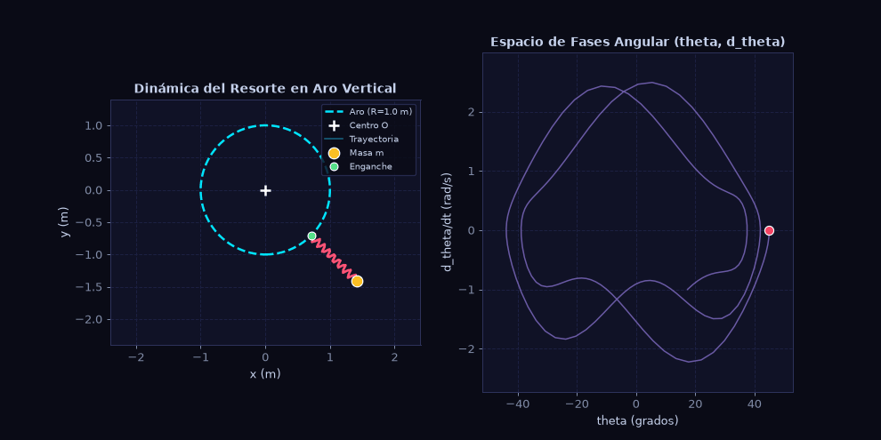

# Dinámica Lagrangiana de un Resorte en un Aro Vertical
### Trabajo de Simulación Numérica — Mecánica y Ondas I
**Grado en Física — Universidad de Córdoba (UCO)**  
**Convocatoria:** Curso 2025–2026 (Ejercicio 1)  
**Autor:** Marcus

---



---

## 1. Descripción del Sistema Físico

El sistema consiste en un aro circular rígido vertical de radio $R$ fijo en el plano cartesiano $Oxy$ con centro en el origen $O(0,0)$. Sobre el aro desliza sin rozamiento el punto de enganche $A$ de un resorte ideal de constante elástica $k$, longitud natural $l_0$ y masa despreciable. En el otro extremo del resorte se encuentra unida una masa puntual $m$, sometida al campo gravitatorio uniforme $\vec{g} = -g\,\hat{\jmath}$.

* **Grados de libertad:** $l = 2$.
* **Coordenadas generalizadas:** $q = (r, \theta)$, donde $r(t)$ es la longitud instantánea del resorte (elongación $\Delta l = r - l_0$) y $\theta(t)$ es el ángulo respecto a la vertical descendente.
* **Lagrangiana del sistema:**
  $$L(r, \theta, \dot{r}, \dot{\theta}) = \frac{1}{2}m\left[ \dot{r}^2 + (R + r)^2\dot{\theta}^2 \right] - \frac{1}{2}k(r - l_0)^2 + mg(R + r)\cos\theta$$
* **Fuerza vincular normal del aro:** Obtenida mediante multiplicadores de Lagrange con la ligadura $f(\rho_A) = \rho_A - R = 0$:
  $$\vec{N}_{\text{aro}} = \lambda(t)\,\hat{u}_r = -k(r - l_0)\,\hat{u}_r$$

---

## 2. Requisitos e Instalación

Para ejecutar la simulación se requiere **Python 3.8 o superior** y las bibliotecas científicas estándar listadas en `requirements.txt` (`numpy`, `scipy`, `matplotlib`).

### Paso 1: Clonar el repositorio
```bash
git clone https://github.com/TU_USUARIO/TU_REPOSITORIO.git
cd TU_REPOSITORIO
```

### Paso 2: Instalar dependencias
```bash
pip install -r requirements.txt
```

---

## 3. Instrucciones de Ejecución

### Simulación Interactiva Principal
Para abrir la interfaz gráfica interactiva en tiempo real:
```bash
python simulacion_interactiva.py
```

#### Controles de la interfaz:
* **Sliders interactivos en tiempo real:**
  * Parámetros físicos: masa $m$, constante elástica $k$, radio del aro $R$, longitud natural $l_0$, gravedad $g$.
  * Condiciones iniciales: ángulo inicial $\theta_0$, velocidad angular $\dot{\theta}_0$, elongación inicial $\Delta r_0$, velocidad radial $\dot{r}_0$.
* **Botones de Casos Límite Físicos:**
  * **Caso Base:** Parámetros estándar del problema.
  * **Péndulo Rígido ($k \to \infty$):** Resorte indeformable; reproduce idénticamente un péndulo simple de longitud $L = R + l_0$.
  * **Sin Gravedad ($g = 0$):** Coordenada $\theta$ cíclica; conservación del momento canónico $p_\theta = m(R+r)^2\dot{\theta}$.
  * **Péndulo Elástico ($R \to 0$):** Punto de suspensión colapsa en el origen $O(0,0)$.
  * **Resonancia 1:2:** Acoplamiento con transferencia periódica de energía ($\omega_r \approx 2\omega_\theta$).
* **Telemetría HUD:** Monitoreo en tiempo real de coordenadas, velocidades, energías ($T, V, E$), error relativo de conservación $\Delta E/E_0$, fuerza normal $\lambda$ y momento angular $p_\theta$.
* **Vector de Reacción:** Flecha magenta que muestra en tiempo real la magnitud y dirección de la fuerza normal $\vec{N}_{\text{aro}}$ ejercida por el aro sobre el enganche.

### Generación de Láminas del Estudio Sistemático
Para regenerar las dos láminas del estudio sistemático a alta resolución (300 DPI):
```bash
python estudio_sistematico.py
```
Generará `dossier_lamina_1.png` (dinámica y balance de energía) y `dossier_lamina_2.png` (verificación física de límites y fuerza normal).

---

## 4. Memoria y Documentación

El repositorio incluye la memoria técnica completa del trabajo en formato PDF:
* [**`Memoria_Trabajo_Simulacion.pdf`**](Memoria_Trabajo_Simulacion.pdf): Informe académico completo de 6 páginas con los desarrollos analíticos paso a paso de los apartados b, c y d, diagrama esquemático TikZ, análisis del movimiento, discusión de las figuras de simulación y conclusiones.
* **`Memoria_Trabajo_Simulacion.tex`**: Código fuente en LaTeX del informe.

---

## 5. Estructura del Repositorio

```text
├── simulacion_interactiva.py     # Programa ejecutable principal (interfaz interactiva a 60 FPS)
├── estudio_sistematico.py        # Script para la resolución numérica y generación de figuras
├── requirements.txt              # Dependencias de Python necesarias
├── README.md                     # Descripción del proyecto e instrucciones de ejecución
├── .gitignore                    # Archivos y temporales ignorados por Git
├── Memoria_Trabajo_Simulacion.pdf# Memoria académica completa del trabajo
├── Memoria_Trabajo_Simulacion.tex# Código fuente en LaTeX de la memoria
├── dossier_lamina_1.png          # Figura 1: Dinámica temporal y conservación de energía
├── dossier_lamina_2.png          # Figura 2: Casos límite y fuerza de ligadura
└── resorte_simulacion.gif        # Animación demostrativa del movimiento
```
